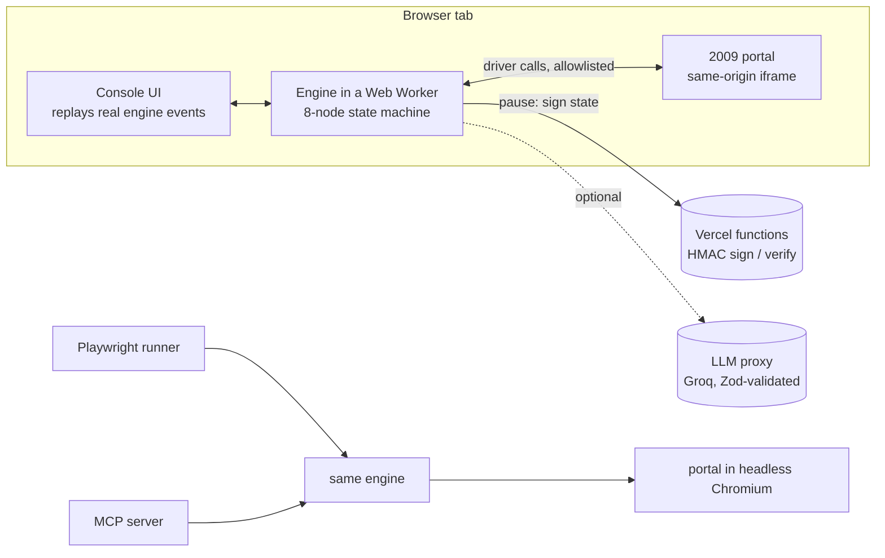

# ForwardDeploy OS

**Messy enterprise data in. Clean records into a 20-year-old portal out. Nothing moves money without proof.**

[](https://github.com/Sohail-5678/forward-deploy-os/actions/workflows/ci.yml) [](LICENSE)

A self-healing ETL pipeline and browser agent for the work forward-deployed engineers actually do: a vendor's export changes overnight, two documents disagree about money, and the system of record is a 2009 web portal with no API. It runs entirely in your browser (a Web Worker), costs $0 to host, and every number it claims is re-runnable.

- **Live demo:** https://forward-deploy-os.vercel.app
- **Watch the 90-second demo:** https://forward-deploy-os.vercel.app/?play=1 (Director Mode runs the real engine on Scenario 5 with captions).

All data in this repository and on the site is synthetic.

## The problem in three sentences

Vendor exports drift without notice (renamed columns, new date and money formats), so nightly imports break. Invoices, CSV rows and purchase orders disagree, and someone has to decide when money is at stake. The system of record is a legacy portal that changes its HTML with every release, so recorded RPA scripts fail.

## How it works



| # | Node | What it does |
|---|---|---|
| 1 | Ingest & Firewall | Parse every file, scan each text channel for hidden instructions, quarantine hostile documents. |
| 2 | Schema Drift Detector | Validate rows against the contract and report field-level drift; failing rows go to quarantine. |
| 3 | Heal & Invariant Gate | Synthesize a declarative mapping (Hungarian assignment over name + value scores), prove it with 5 invariants, promote only safe rows. |
| 4 | Cross-Doc Reconciler | Compare PDF, CSV and ERP purchase order per invoice; calibrated logistic confidence. |
| 5 | Policy & HITL Gate | Hard policy rules first; pause at an HMAC-signed checkpoint when a human must decide. |
| 6 | DOM Distiller | Read the portal as a compact numbered text map of its interactive elements. |
| 7 | Portal Executor | Bind approved values in code, check every action with the tool boundary guard, heal broken selectors, post. |
| 8 | Audit Commit | Seal the hash-chained audit log and produce the run summary. |

## Results

<!-- results:start -->
_Generated from `benchmarks/results.json` (2026-10-14T19:00:38.031Z, seed 20261014, Node v26.6.0). Do not edit by hand: run `npm run readme:results`._

| Metric | Value | Detail | Cases | Seed |
|---|---|---|---|---|
| Fields mapped correctly | **97.8%** | exact-name baseline 11.4%; full-file heal 84% vs 0% | 200 | 20261014 |
| Smaller than raw HTML | **9.5x** | median on portal pages; up to 60x on enterprise fixtures; 100% task success | 203 | 20261014 |
| Broken selectors healed | **100%** | 0 wrong-element actions; recorded CSS-id baseline 85.7% | 350 | 20261014 |
| Expected calibration error | **0.049** | Brier 0.0753; uncalibrated heuristic ECE 0.1726 | 1000 | 8312026 |
| Malicious actions blocked | **100%** | by the always-on guard, 150 plans; the scanner alone detects 80% at 0% false positives | 150 | 20261014 |
| Duplicate postings | **0** | 95 duplicates prevented across 50 replayed batches | 50 | 20261014 |

| Budget | Target | Measured | Status |
|---|---|---|---|
| Nodes 1-5, 100-row batch (p95, worst node) | under 50 ms per node | 4.16 ms | met |
| Distillation of one portal page (p95) | under 20 ms | 34.0 ms | **missed** |
| Selector heal, one element (p95) | under 20 ms | 0.03 ms | met |
| Landing page LCP | under 2.5 s | not measured | not measured |
| Lighthouse performance / accessibility / best practices | >= 90 / >= 95 / >= 95 | not measured | not measured |
| Console playback | 60 fps on a mid-range laptop | shown live in the console | not measured |
<!-- results:end -->

## How to verify every claim

```bash
npm run bench          # re-run every seeded suite, rewrite benchmarks/results.json
npm run bench:check    # fail if the committed results no longer match the code
npm test               # unit, property (fast-check), red-team and API tests
npm run test:integration   # Playwright agent runner, MCP server, exported scripts
npx playwright test    # E2E: scenarios, HITL decisions, tamper rejection, Director Mode, keyboard-only, axe
```

Or open `/benchmarks` and press **Re-run live**: the deterministic suites run again in your browser and are compared with the committed file.

## Design decisions

| Decision | Chosen | Alternatives | Why |
|---|---|---|---|
| Where the engine runs | Browser Web Worker, same code on server | Server only | $0, no timeouts, every visitor gets a real run |
| Legacy portal | Static HTML in a same-origin iframe | React component; remote browser cloud | Behaves like a separate app; same page for Playwright; free |
| Page understanding | Distilled accessibility tree | Screenshots + vision model | Faster, cheaper, deterministic, measurable |
| Healing output | Declarative TransformSpec | LLM-generated code | No code execution risk; auditable; testable |
| Who supplies typed values | Code, from the approved record (value binding) | LLM fills values | Removes the main prompt-injection impact path |
| Escalation | Hard policy rules first, calibrated confidence second | Confidence only | Money rules must not depend on a model score |
| Checkpoint integrity | HMAC-signed state hash | Trust the client; database | Stateless, $0, tamper-evident |
| Audit | Hash-chained log | Plain log | Tamper-evident and cheap to verify |
| LLM | Optional, server-side, capped | Required LLM | Demo always works; cost cannot run away |
| Proof | Seeded suites with baselines, results committed, CI drift check | Hand-written numbers | Every claim is reproducible |

### Honest limitations

- Text PDFs only; scanned PDFs (OCR) are out of scope.
- The ERP and vendor master are mock JSON; the portal is a fictional static site.
- Without Upstash Redis, rate limiting is in-memory per serverless instance (best effort).
- The injection scanner is a detector with a measured false-positive rate and known misses (listed on `/benchmarks` and in `tests/red-team`). What protects the money is value binding, the policy gate and the always-on guard, not detection.
- The "LangGraph-style" state machine is a small custom graph so checkpoints and forks stay visible and testable; it is not LangGraph.

## Run locally

```bash
npm install
npx playwright install chromium
npm run dev
```

Open http://localhost:3000. Everything works with no environment variables. Optional settings (`.env.example`):

| Variable | Purpose |
|---|---|
| `CHECKPOINT_SECRET` | Required in production: HMAC key for HITL checkpoints (`npm run secret` prints one). Development uses an ephemeral key. |
| `GROQ_API_KEY`, `GROQ_MODEL` | Optional LLM assist (default model `llama-3.3-70b-versatile`). Visitors can also bring their own key. |
| `LLM_DAILY_CAP` | Daily cap on calls made with the site's key (default 300). |
| `SLACK_WEBHOOK_URL` | Optional: send escalations to Slack as Block Kit. |
| `UPSTASH_REDIS_REST_URL`, `UPSTASH_REDIS_REST_TOKEN` | Optional shared rate limiting. |
| `NEXT_PUBLIC_SITE_URL` | Canonical URL for metadata. |

Other tools:

```bash
npm run runner -- --scenarios 1,2,3,4,5   # the real agent in headless Chromium (add --headed --slow 120 to watch)
npm run baseline                          # the brittle recorded script failing after the portal release
npm run screenshots -- http://localhost:3000   # regenerate og.png and the portal screenshot
```

## Use the MCP server with Claude

The portal is exposed as three guarded tools (`search_purchase_order`, `get_invoice_form_schema`, `submit_invoice`). A model can submit invoices but can never approve an exception: anything that needs a human is escalated and not posted.

```bash
claude mcp add forwarddeploy-os -- npx tsx mcp-server/server.ts
```

Claude Desktop configuration and examples: [mcp-server/README.md](mcp-server/README.md).

## Security

See [SECURITY.md](SECURITY.md) for the threat model and the layers (normalization, scanner, spotlighting, value binding, policy gate, tool boundary guard, signed checkpoints, CSP, rate limits).

## Author

Built by **Ameer Sohail Shaik** · [GitHub](https://github.com/Sohail-5678) · [Portfolio](https://ameer-shaik.vercel.app/) · [LinkedIn](https://www.linkedin.com/in/ameer-shaik-9a6309202/)

All data is synthetic. MIT licensed.
